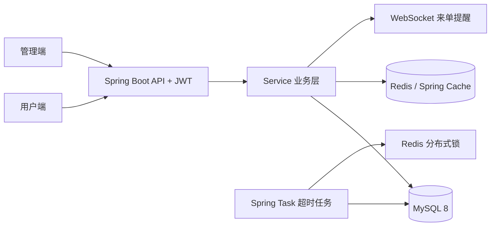

# Prisdvl-Order 外卖订单管理系统


Prisdvl-Order 是一个前后端分离的外卖业务系统后端，覆盖用户点餐、购物车、订单支付、菜品/套餐管理、商家接单派送、运营数据看板等完整链路。

项目在经典外卖业务模型基础上完成了工程化整改，重点解决了订单列表 N+1、菜单缓存一致性、超时订单批量处理、支付回调幂等和 JWT 上下文泄漏等问题。

> 仓库：[github.com/Prisdvl/prisdvl-order](https://github.com/Prisdvl/prisdvl-order)
>
> 包名：`com.prisdvl.order`　｜　端口：`8080`　｜　接口文档：`http://localhost:8080/doc.html`

## 项目简介

### 这个项目解决了什么

- **完整业务闭环**：用户浏览菜单 → 加购物车 → 下单 → 支付 → 商家接单/派送 → 完成，管理端同步管理菜品、套餐、订单和营业数据。
- **可量化的性能优化**：订单列表一页 10 条从 12 条 SQL 降到 3 条；菜品列表从 11 条降到 2 条；批量删除从约 30 条降到 3～4 条。
- **真实的缓存设计**：不是简单 `RedisTemplate.get/set`，而是 Spring Cache + 按业务设置 TTL + 写操作精准失效 + 事务提交后失效。
- **可靠性处理**：超时订单批量条件更新、Redis 分布式锁、支付回调幂等、JWT ThreadLocal 清理、WebSocket 僵尸会话清理。

### 功能清单

| 端 | 功能 |
|---|---|
| 用户端 | 微信登录、分类/菜品/套餐浏览、购物车、下单、支付、历史订单、订单详情、取消订单、再来一单、催单、地址簿 |
| 管理端 | 员工登录、分类管理、菜品管理、套餐管理、订单搜索、接单/拒单/派送/完成、营业数据、报表导出、店铺营业状态 |
| 实时能力 | 支付成功来单提醒、用户催单提醒、WebSocket 心跳 |

### 接口分组

| 前缀 | 说明 |
|---|---|
| `/admin/**` | 管理端接口，JWT 管理端令牌 |
| `/user/**` | 用户端接口，JWT 用户端令牌 |
| `/notify/**` | 微信支付回调 |
| `/ws/{sid}` | 管理端 WebSocket 来单/催单提醒 |

## 技术栈

| 层次 | 技术 |
|---|---|
| 基础框架 | Java 17、Spring Boot 2.7.3、Spring MVC |
| 持久层 | MyBatis、PageHelper 1.4.1、Druid、MySQL 8 |
| 缓存 | Redis、Spring Cache、Lettuce |
| 认证 | JWT（jjwt）、HandlerInterceptor、ThreadLocal |
| 异步/定时 | Spring Task、WebSocket |
| 文档 | Knife4j / Swagger |

### 模块划分

| 模块 | 职责 |
|---|---|
| `prisdvl-common` | 统一返回、常量、异常、JWT、OSS、微信支付工具 |
| `prisdvl-pojo` | Entity / DTO / VO |
| `prisdvl-server` | Controller、Service、Mapper、缓存、定时任务、WebSocket |

## 系统架构



请求主链路：

```text
Controller → Service → Mapper → MySQL
                ↓
         Spring Cache / Redis
                ↓
         WebSocket 管理端提醒
```

## 快速开始

### 1. 环境要求

- JDK 17
- Maven 3.8+
- MySQL 8.0+
- Redis 6.0+

> Spring Boot 2.7.3 不建议直接用 JDK 21，JDK 17 已验证可编译、可启动。

### 2. 克隆项目

```bash
git clone https://github.com/Prisdvl/prisdvl-order.git
cd prisdvl-order
```

如果 HTTPS 访问不稳定，也可以使用 SSH：

```bash
git clone git@github.com:Prisdvl/prisdvl-order.git
```

### 3. 准备数据库

创建数据库 `sky_take_out`，导入你现有的表结构（本仓库聚焦后端代码与优化，未重复附带建表 SQL），然后执行索引脚本：

```bash
mysql -uroot -p sky_take_out < db/prisdvl_order_indexes.sql
```

索引脚本包含订单、订单明细、菜品、口味、套餐、购物车、分类等高频查询索引。

### 4. 修改配置

编辑 `prisdvl-server/src/main/resources/application-dev.yml`，填入本地数据库、Redis、微信支付配置。

真实密码和密钥不要提交，建议放在 `application-dev.yml.local`（已加入 `.gitignore`）。

### 5. 构建并启动

```bash
mvn clean package -DskipTests
java -jar prisdvl-server/target/prisdvl-server-1.0-SNAPSHOT.jar
```

启动后访问：

- 接口文档：`http://localhost:8080/doc.html`
- 服务端口：`8080`

### 6. 运行测试

```bash
mvn test
```

当前测试不依赖 MySQL/Redis，主要覆盖缓存 JSON 序列化往返；完整的下单、支付回调、超时任务链路需要本地启动 MySQL 和 Redis 后验证。

## 核心设计

### 1. 订单列表 N+1：整页固定 3 条 SQL

**问题**：用户端历史订单、管理端订单搜索先分页查 `orders`，再在循环里按 `orderId` 逐单查 `order_detail`。PageHelper 分页本身有 `count` + `limit` 两条 SQL，再叠加 10 条明细，一页 10 条订单共 12 条 SQL。

**改造**：

- 新增 `OrderDetailMapper#getByOrderIds`，一次 `WHERE order_id IN (...)` 查出当前页全部明细；
- `OrderServiceImpl` 按 `order_id` 分组为 `Map<Long, List<OrderDetail>>`，再回填 `OrderVO`；
- 用户端 `pageQuery4User` 与管理端 `conditionSearch` 复用同一套批量装配逻辑；
- 管理端菜品字符串也复用这份明细，不再逐单查询。

**结果**：整页 SQL 从 12 条降到 3 条（`count` + `limit` + 1 条 IN 明细），明细查询从 10 条降到 1 条。

相关代码：[OrderServiceImpl.java](prisdvl-server/src/main/java/com/prisdvl/order/service/impl/OrderServiceImpl.java)、[OrderDetailMapper.java](prisdvl-server/src/main/java/com/prisdvl/order/mapper/OrderDetailMapper.java)

### 2. 菜单口味 N+1：一次 IN 查询

用户端按分类查看菜品时，原来先查 `dish` 列表，再对每个菜品查一次口味。10 个菜品就是 `1 + 10 = 11` 条 SQL。

现在新增 `DishFlavorMapper#getByDishIds`，一次查出当前分类下所有口味，按 `dishId` 分组后回填 `DishVO`；没有口味的菜品回填空列表，避免前端出现 `null`。

**结果**：`1 + N` → `2` 条 SQL。

相关代码：[DishServiceImpl.java](prisdvl-server/src/main/java/com/prisdvl/order/service/impl/DishServiceImpl.java)

### 3. 批量删除与状态联动

- 菜品批量删除：一次 `getByIds` 校验 + 一次 `deleteByIds` + 一次 `deleteByDishIds`，10 条约 31 条 SQL → 4 条；
- 套餐批量删除：一次查询 + 两条批量删除，10 条约 30 条 SQL → 3 条；
- 菜品停售联动套餐：一条 `UPDATE setmeal SET status = 0 WHERE id IN (...)`，M 个套餐从 `2 + M` → 3 条；
- 订单状态统计：3 次 `count` → 1 次 `GROUP BY status`。

### 4. Spring Cache + Redis 缓存设计

缓存实现位于 `RedisConfiguration`，业务注解在 Service 层，Controller 不再手工读写 Redis。

| 缓存名 / Redis Key | Key | 缓存内容 | TTL | 失效时机 |
|---|---|---|---|---|
| `dish` | 分类 id | `List<DishVO>`（含口味） | 30 分钟 | 菜品新增/修改/删除/起售停售 |
| `setmeal` | 分类 id | `List<Setmeal>` | 30 分钟 | 套餐写操作、菜品停售联动 |
| `category` | 分类类型 / `all` | `List<Category>` | 60 分钟 | 分类新增/修改/删除/启停 |
| `SHOP_STATUS` | 固定 key | 营业状态 `Integer` | 不设置 | 管理端修改营业状态时覆盖 |

设计要点：

1. **统一 key 前缀**：`prisdvl:cache:dish::101`，便于按业务排查和清理；
2. **JSON 序列化**：`GenericJackson2JsonRedisSerializer` + `JavaTimeModule`，支持 `LocalDateTime`，并用 `BasicPolymorphicTypeValidator` 限制可反序列化的包；
3. **写后失效**：`@CacheEvict` 放在 Service 写方法上，避免 Controller 漏删；菜品写操作同时清 `dish` 和 `setmeal`；
4. **事务提交后失效**：`RedisCacheManager#transactionAware()` 让缓存失效跟随事务提交，避免“缓存已删、事务未提交”期间读到旧数据；
5. **空列表也缓存**：`disableCachingNullValues` 只禁止 `null`，空 `List` 正常缓存，用于挡住不存在的分类 id；
6. **同一节点防击穿**：`@Cacheable(sync = true)`，同一 JVM 内并发回源只放一个线程查库；
7. **Cache-Aside**：读时回源、写时删除，不直接改缓存值，避免并发写导致缓存与数据库不一致。

相关代码：[RedisConfiguration.java](prisdvl-server/src/main/java/com/prisdvl/order/config/RedisConfiguration.java)

### 5. 超时订单自动取消

`OrderTask` 每分钟执行一次，从“查列表 + 逐条 update”改为“批量条件更新”：

```sql
UPDATE orders
SET status = 6,
    cancel_reason = '订单超时，自动取消',
    cancel_time = NOW()
WHERE status = 1
  AND order_time < #{deadline}
ORDER BY id
LIMIT 500
```

- 单批 500 条，循环直到不足一批，避免一次性锁过多行；
- `status = 1` 同时是业务条件和乐观锁条件，已支付订单不会被误取消；
- 多实例部署时用 Redis 分布式锁 `lock:order:task:timeout` 互斥，锁 TTL 5 分钟，Lua 脚本按持有者标识释放；
- 超时时间通过 `sky.order.timeout-minutes` 配置，默认 15 分钟；
- 派送中订单自动完成同样批量化，锁 key 为 `lock:order:task:delivery`。

相关代码：[OrderTask.java](prisdvl-server/src/main/java/com/prisdvl/order/task/OrderTask.java)、[RedisDistributedLock.java](prisdvl-server/src/main/java/com/prisdvl/order/component/RedisDistributedLock.java)

### 6. 支付回调幂等与鉴权上下文

- 支付回调没有登录上下文，改为按商户订单号 `number` 查询，避免 `BaseContext` 为 `null` 导致 NPE；
- 支付状态更新改为条件更新：`WHERE id = ? AND status = 1 AND pay_status = 0`，重复回调返回 0 行后忽略，不重复推送来单提醒；
- 用户取消订单改为 `WHERE id = ? AND user_id = ?`，防止越权取消他人订单；
- JWT 拦截器在 `afterCompletion` 中调用 `BaseContext.removeCurrentId()`，解决 Tomcat 线程复用导致的身份串号和 ThreadLocal 泄漏；
- 401 返回统一 JSON，日志不再打印 token；JWT 密钥支持 `SKY_JWT_ADMIN_SECRET`、`SKY_JWT_USER_SECRET` 环境变量注入。

相关代码：[OrderServiceImpl.java](prisdvl-server/src/main/java/com/prisdvl/order/service/impl/OrderServiceImpl.java)、[JwtTokenAdminInterceptor.java](prisdvl-server/src/main/java/com/prisdvl/order/interceptor/JwtTokenAdminInterceptor.java)

### 7. WebSocket 来单提醒

- `ConcurrentHashMap` 保存在线会话，替代原来的 `HashMap`；
- `@OnError`、推送失败、连接关闭都会摘除会话，避免僵尸连接；
- 同一 `Session` 的发送加锁串行化，避免并发 `sendText` 抛 `IllegalStateException`；
- 支持 `ping` / `pong` 心跳；
- 支付成功推送 `type=1` 来单提醒，用户催单推送 `type=2`。

相关代码：[WebSocketServer.java](prisdvl-server/src/main/java/com/prisdvl/order/websocket/WebSocketServer.java)

### 8. 索引与工程化

`db/prisdvl_order_indexes.sql` 提供与上述 SQL 对应的索引：

- `orders(user_id, status, order_time)`：用户端历史订单；
- `orders(status, order_time)`：超时扫描、管理端条件搜索；
- `orders(number)`：支付回调按订单号查询；
- `order_detail(order_id)`：详情与订单列表 IN 查询；
- `dish(category_id, status, create_time)`、`setmeal(category_id, status)`：用户端菜单；
- `dish_flavor(dish_id)`、`setmeal_dish(setmeal_id)`、`setmeal_dish(dish_id)`：批量装配与关联校验；
- `shopping_cart(user_id)`、`category(status, type, sort, create_time)`、`employee(username)`、`user(openid)`。

其他工程化整改：

- PageHelper `1.3.0 → 1.4.1`，消除与 Spring Boot 2.7 的循环依赖，移除 `spring.main.allow-circular-references: true`；
- 删除没有实际调度的示例任务和依赖外部服务的 Demo 测试；
- 增加 `CacheSerializerTest`，在不启动 Redis 的情况下覆盖 `DishVO`（含 `LocalDateTime`、嵌套口味）的缓存序列化往返；
- `mvn test` 不依赖外部服务。

## 量化对比

| 场景 | 改造前 | 改造后 |
|---|---|---|
| 用户历史订单（一页 10 条） | 分页 2 条 + 10 次明细 = 12 | 分页 2 条 + 1 条 IN = 3 |
| 管理端订单搜索（一页 10 条） | 分页 2 条 + 10 次明细 = 12 | 分页 2 条 + 1 条 IN = 3 |
| 用户菜品列表（10 个菜品） | 1 次菜品 + 10 次口味 = 11 | 1 + 1 = 2 |
| 菜品批量删除 10 条 | 约 31 条 | 4 条 |
| 套餐批量删除 10 条 | 约 30 条 | 3 条 |
| 订单状态统计 | 3 条 count | 1 条 group by |
| 菜品停售联动 M 个套餐 | 2 + M 条 | 3 条 |
| 菜单缓存命中 | 每次 2 条 SQL 回源 | 0 条 SQL 回源 |

## 项目结构

```text
prisdvl-order
├── prisdvl-common                 # 通用返回、常量、异常、JWT/OSS/微信支付工具
├── prisdvl-pojo                   # entity / dto / vo
├── prisdvl-server                 # controller / service / mapper / task / websocket / config
│   └── src/main/resources
│       ├── mapper                 # MyBatis XML
│       ├── application.yml        # 主配置
│       └── application-dev.yml    # 本地配置占位符
├── db
│   └── prisdvl_order_indexes.sql  # 索引优化脚本
└── README.md
```

## 测试与验证

仓库内已验证：

- `mvn clean package` 构建通过（JDK 17）；
- `CacheSerializerTest` 通过，覆盖 `DishVO` 中 `LocalDateTime`、`BigDecimal` 和嵌套口味的 JSON 序列化往返；
- Spring Boot 启动冒烟测试通过，Tomcat、Bean 装配、PageHelper 正常；
- 临时 Redis 环境下的缓存 `put/get/evict` 验证通过。

说明：仓库内的自动化测试不依赖外部服务；下单、支付回调、定时任务 SQL 需要在本地启动 MySQL/Redis 后做端到端验证；`db/prisdvl_order_indexes.sql` 需要在业务库执行一次。

## 后续可继续优化

- 用 Redisson 替代手写 Redis 锁，支持看门狗续期；
- 缓存 TTL 增加随机抖动，进一步降低雪崩风险；
- 支付回调增加微信签名验签与金额校验；
- 订单状态流转抽成状态机，统一处理取消/退款/超时竞争；
- 引入消息队列解耦支付成功后的通知、积分、报表等下游动作；
- 补充建表 SQL 和 Docker Compose，降低本地启动成本。

## 安全说明

- 仓库中的 `application-dev.yml` 是配置占位符，不包含真实数据库密码、微信 `appid/secret`、API v3 key 或支付证书路径；
- 真实配置放在 `application-dev.yml.local`（已加入 `.gitignore`），不要提交；
- JWT 密钥支持 `SKY_JWT_ADMIN_SECRET`、`SKY_JWT_USER_SECRET` 环境变量覆盖。

## 相关文件

- [索引优化脚本](db/prisdvl_order_indexes.sql)
